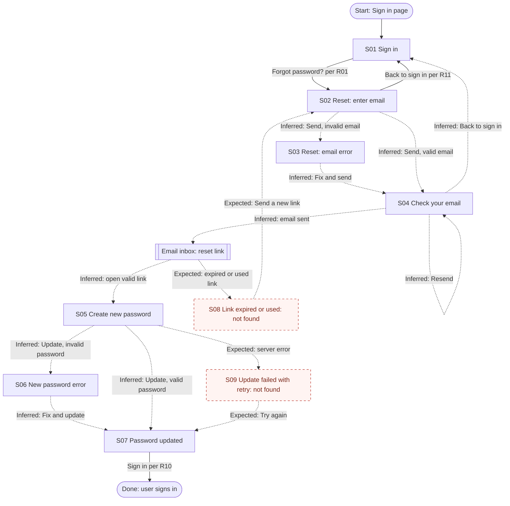

# FlowGuard Audit: Password Reset

> T15 export test output generated from the fictional example inputs. Not a real product audit.

## 1. Audit metadata

| Field | Value |
| --- | --- |
| Product or module | Example banking web app: Password reset |
| Audit mode | Standard |
| Audit date | Not provided |
| Requirements source | `examples/sample-requirements.md` (R01 to R11, acceptance criteria) |
| Design evidence | `examples/sample-screen-inventory.md` (text description of 7 frames) |
| Access method | Local file read |
| Artifacts not usable | None |
| Coverage limitations | Designs are text descriptions, not images. Visual properties (contrast, spacing, target size) could not be assessed. No prototype connections were supplied. |

## 2. Executive summary

The supplied designs cover the main reset path from sign in to a successful password update, including inline validation for the email and password fields. Two required recovery paths were not found in the supplied evidence: the expired or already used link screen (R06) and the server-error retry state on password update (R09). The password helper text omits the "must not match the previous password" rule from R07, so users may hit an undesigned error. All transitions except three are inferred from frame order and labels because no prototype data was supplied.

**Summary of evidence**

- Requirements identified: 11 explicit, 1 provisional
- Screens and states inventoried: 9 (7 verified, 0 inferred, 2 missing from supplied evidence, 0 unknown)
- Transitions mapped: 18 (4 verified, 10 inferred, 4 expected but missing from supplied evidence)
- Findings: 4 (P0: 0, P1: 2, P2: 1, P3: 1)
- Unresolved decisions: 3

These counts describe the supplied evidence. They do not measure completeness.

## 3. Evidence and assumptions

### Requirements

| ID | Requirement | Source | Status |
| --- | --- | --- | --- |
| R01 | "Forgot password?" on sign in opens reset request | sample-requirements.md | Explicit |
| R02 | Reset request asks for registered email | sample-requirements.md | Explicit |
| R03 | Inline error for empty or invalid email | sample-requirements.md | Explicit |
| R04 | Same confirmation whether or not the account exists | sample-requirements.md | Explicit |
| R05 | Link expires after 30 minutes, single use | sample-requirements.md | Explicit |
| R06 | Expired or used link shows explanation and new-link action | sample-requirements.md | Explicit |
| R07 | Password: 12+ characters, a number, not the previous password | sample-requirements.md | Explicit |
| R08 | Show or hide password | sample-requirements.md | Explicit |
| R09 | Server error on update shows error and retry without retyping | sample-requirements.md | Explicit |
| R10 | Success screen with "Sign in"; other sessions signed out | sample-requirements.md | Explicit |
| R11 | Cancel from reset request returns to sign in | sample-requirements.md | Explicit |
| PR01 | Submitting actions show a loading state | Domain convention | Provisional |

### Assumptions

| ID | Assumption | Reason | Impact if wrong |
| --- | --- | --- | --- |
| A01 | Frame order on the canvas reflects the intended flow order. | Designer note states frames are ordered left to right. | Inferred transitions may be wrong. |
| A02 | The email link opens S05 directly in the same browser. | Typical pattern; not specified. | Cross-device handling may need its own state. |

## 4. Screen inventory

| ID | Name (alias) | Purpose | Category | Actions | Evidence | Classification | Notes |
| --- | --- | --- | --- | --- | --- | --- | --- |
| S01 | Sign in ("Login") | Sign in, start reset | Entry | Sign in, Forgot password? | Frame 1 | Verified | |
| S02 | Reset: enter email ("Reset - Enter email") | Request reset link | Form | Send reset link, Back to sign in | Frame 2 | Verified | |
| S03 | Reset: email error ("Reset - Enter email (error)") | Show invalid email error | Error | Send reset link, Back to sign in | Frame 3 | Verified | Distinct state of S02, not a duplicate. |
| S04 | Check your email ("Check your inbox") | Neutral confirmation | Confirmation | Resend, Back to sign in | Frame 4 | Verified | Copy matches R04 and R05. |
| S05 | Create new password ("New password") | Set new password | Form | Show or hide, Update password | Frame 5 | Verified | Helper text omits the previous-password rule. |
| S06 | New password error ("New password (error)") | Show length error | Error | Update password | Frame 6 | Verified | Only the length error is shown. |
| S07 | Password updated | Confirm success | Success | Sign in | Frame 7 | Verified | |
| S08 | Link expired or used | Explain and offer new link | Error | Send a new link (expected) | Required by R06 | Missing from supplied evidence | Not found in any of the 7 frames. |
| S09 | Update failed with retry | Recover from server error | Error | Try again (expected) | Required by R09 | Missing from supplied evidence | Not found in any of the 7 frames. |

## 5. Flow overview

The user starts at sign in, opens the reset request, enters an email, and sees a neutral confirmation. The link in the email opens the new password screen. A valid password leads to the success screen and back to sign in. Validation errors for the email and password fields loop back to their forms. Recovery for expired links and server errors is required but was not found.

Legend: solid arrow = verified, dashed arrow = inferred or expected, dashed node border = missing from supplied evidence.

## 6. Transition inventory

| ID | Source | Trigger | Condition | Destination | Evidence | Classification | Related reqs | Uncertainty |
| --- | --- | --- | --- | --- | --- | --- | --- | --- |
| T00 | Entry | Visit sign in | None | S01 | R01 | Verified | R01 | |
| T01 | S01 | Forgot password? | None | S02 | R01 names both ends | Verified | R01 | |
| T02 | S02 | Send reset link | Email invalid or empty | S03 | Frame order, error copy | Inferred | R03 | Empty-field message not shown separately. |
| T03 | S02 | Send reset link | Email valid | S04 | Frame order | Inferred | R04 | |
| T04 | S02 | Back to sign in | None | S01 | R11 names both ends | Verified | R11 | |
| T05 | S03 | Fix and send | Email valid | S04 | Frame order | Inferred | R03 | |
| T06 | S04 | Back to sign in | None | S01 | Link label | Inferred | | |
| T07 | S04 | Resend | None | S04 | Link label | Inferred | R05 | No feedback state after resend. |
| T08 | S04 | Email sent | Account exists | External: inbox | R05 | Inferred | R05 | |
| T09 | External: inbox | Open link | Link valid | S05 | Frame order | Inferred | R05 | Cross-device behavior unknown. |
| T10 | External: inbox | Open link | Expired or used | S08 | R06 | Missing from supplied evidence | R06 | |
| T11 | S08 | Send a new link | None | S02 | R06 | Missing from supplied evidence | R06 | |
| T12 | S05 | Update password | Invalid password | S06 | Frame order | Inferred | R07 | Only length error designed. |
| T13 | S05 | Update password | Valid, server OK | S07 | Frame order | Inferred | R10 | |
| T14 | S05 | Update password | Server error | S09 | R09 | Missing from supplied evidence | R09 | |
| T15 | S09 | Try again | None | S07 | R09 | Missing from supplied evidence | R09 | |
| T16 | S06 | Fix and update | Valid | S07 | Frame order | Inferred | R07 | |
| T17 | S07 | Sign in | None | Exit to sign in | R10 names both ends | Verified | R10 | |

## 7. Prioritized findings

### F01: Expired or already used reset link has no designed state

| Field | Detail |
| --- | --- |
| Category | Recovery |
| Priority | P1: Required by R06; users with an old link cannot continue and see no path forward; workaround exists (start again from sign in) but is not signposted; Missing from supplied evidence. |
| Evidence | R06, R05; all 7 frames in sample-screen-inventory.md reviewed. |
| Expected behavior | An explanation that the link expired or was used, with "Send a new link" returning to S02 (R06). |
| Observed behavior or limitation | No such frame in the supplied evidence. |
| User impact | Users who open the email after 30 minutes, or twice, hit an undefined state and may abandon or contact support. |
| Recommended fix | Add S08 "Link expired or used" with plain-language copy and a primary "Send a new link" action. |
| Classification and confidence | Missing from supplied evidence; Observation: High. Requirement: High. |
| Validation steps | Designer adds S08; reviewer confirms copy covers both expired and used cases; engineer confirms the error is distinguishable from an invalid token. |
| Related IDs | S08, T10, T11 |

### F02: No server-error state or retry on password update

| Field | Detail |
| --- | --- |
| Category | System behavior |
| Priority | P1: Required by R09; a failed update leaves the user without feedback at the last step of a critical task; Missing from supplied evidence. |
| Evidence | R09 and its acceptance criterion; frames 5 to 7. |
| Expected behavior | Error message and "Try again" that resubmits without retyping the password. |
| Observed behavior or limitation | Only validation errors (S06) and success (S07) are designed. |
| User impact | Users may retype passwords repeatedly or assume the reset worked when it did not. |
| Recommended fix | Add S09 with an error banner, preserved input, and "Try again". |
| Classification and confidence | Missing from supplied evidence; Observation: High. Requirement: High. |
| Validation steps | Confirm S09 exists; confirm the password field remains filled after the error; test retry in a staging build. |
| Related IDs | S05, S09, T14, T15 |

### F03: Previous-password rule is not communicated

| Field | Detail |
| --- | --- |
| Category | Forms |
| Priority | P2: Required by R07; users can recover by trying another password, so this is friction rather than a block. |
| Evidence | R07; S05 helper text; S06 error copy. |
| Expected behavior | Helper text lists all three rules, and an error state exists for reusing the previous password. |
| Observed behavior or limitation | Helper text covers length and number only; S06 shows only the length error. |
| User impact | Users may be rejected for a rule they were not told about, with an undesigned message. |
| Recommended fix | Update helper text; add error variants for "needs a number" and "matches previous password". |
| Classification and confidence | Verified (helper text content); Observation: High. Requirement: High. |
| Validation steps | Review copy against R07; confirm each rule has a matching error message. |
| Related IDs | S05, S06, T12 |

### F04: No loading feedback on submit actions

| Field | Detail |
| --- | --- |
| Category | System behavior |
| Priority | P3: Provisional (PR01); minor impact; risk of double submission is mitigated if the button is disabled during requests. |
| Evidence | Frames 2 and 5 show no loading variant. |
| Expected behavior | Buttons show a busy state and prevent double submission. |
| Observed behavior or limitation | Not found in the supplied evidence. |
| User impact | Users may tap twice and receive two emails, or think the app is unresponsive. |
| Recommended fix | Add a loading variant for "Send reset link" and "Update password", or document the system pattern that applies. |
| Classification and confidence | Missing from supplied evidence; Requirement: Medium (provisional). |
| Validation steps | Confirm whether a global loading pattern exists in the design system. |
| Related IDs | S02, S05 |

## 8. Recommended fixes

| Priority | Finding | Fix | Affected screens |
| --- | --- | --- | --- |
| P1 | F01 | Add expired or used link screen with "Send a new link" | S08 |
| P1 | F02 | Add update-failed state with preserved input and retry | S05, S09 |
| P2 | F03 | Complete password rules in helper text and errors | S05, S06 |
| P3 | F04 | Add or reference a loading pattern | S02, S05 |

## 9. Developer-ready issues

### [FlowGuard F01] Handle expired or used password reset links

**Problem:** Opening a reset link after 30 minutes or a second time has no designed outcome.
**Affected states:** S08, T10, T11
**Expected behavior:** Show an explanation and a "Send a new link" action that opens the reset request screen.
**Acceptance criteria:**
- Given a link older than 30 minutes, when the user opens it, then the expired-link screen appears.
- Given a link that was already used, when the user opens it, then the same screen appears.
- When the user selects "Send a new link", then the reset request screen opens.
**Test scenarios:**
1. Open a link at 31 minutes.
2. Use a link, then open it again.
**Source:** FlowGuard audit of Password reset, finding F01 (Missing from supplied evidence).

### [FlowGuard F02] Retry password update after a server error

**Problem:** No designed outcome when the update request fails.
**Affected states:** S05, S09, T14, T15
**Expected behavior:** Error message, password preserved, "Try again" retries the same request.
**Acceptance criteria:**
- Given the update request fails with a server error, when the response returns, then an error message appears and the password field stays filled.
- When the user selects "Try again", then the same password is resubmitted.
**Test scenarios:**
1. Simulate a 500 response on update.
2. Simulate a timeout on update.
**Source:** FlowGuard audit of Password reset, finding F02 (Missing from supplied evidence).

## 10. Validation checklist

- [ ] S08 designed for expired and used links (R06).
- [ ] S09 designed with preserved input and retry (R09).
- [ ] Password helper text and errors cover all R07 rules.
- [ ] Loading pattern defined for both submit actions.
- [ ] Copy on S04 remains neutral about account existence (R04).
- [ ] Decisions Q01 to Q03 answered.

## 11. Unresolved decisions

| ID | Question | Why it matters | Suggested owner | Default if no answer |
| --- | --- | --- | --- | --- |
| Q01 | Should the success screen tell users that other sessions were signed out (R10)? | Users may be surprised when other devices sign out. | Product owner (suggested) | Add one line of copy on S07. |
| Q02 | What feedback appears after "Resend", and is resending rate limited? | Repeated taps could look broken or send many emails. | Product and engineering (suggested) | Show a toast "Link sent" and disable Resend briefly. |
| Q03 | What happens if the link is opened on a different device or browser? | Cross-device users may land on an unexpected state. | Engineering (suggested) | Treat as a normal valid link. |

## 12. Scope and limitations

- This audit reviewed a text description of static designs. It does not verify live product behavior.
- Visual accessibility properties (contrast, target size, focus order) could not be assessed from text.
- No prototype connections were supplied; most transitions are inferred from frame order (A01).
- Backend behavior such as signing out other sessions (R10) and link expiry (R05) cannot be verified from designs.
- FlowGuard does not guarantee a flow is complete and does not replace usability testing.
