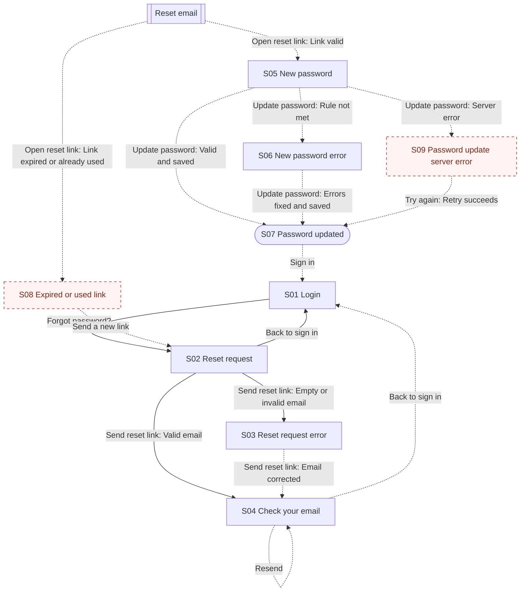

# FlowGuard Audit: Password reset

## 1. Audit metadata

| Field | Value |
| --- | --- |
| Product or module | Example banking web app, Password reset (illustrative) |
| Audit mode | Standard |
| Audit date | Not provided |
| Requirements source | examples/sample-requirements.md, R01 to R11 and acceptance criteria |
| Design evidence | examples/sample-screen-inventory.md, 7 frames described in text |
| Access method | Local file read |
| Artifacts not usable | None |
| Coverage limitations | Text descriptions only; no prototype connections; reset email not supplied |

## 2. Executive summary

Seven frames cover the reset request, inline email error, neutral confirmation, new password entry with a length error, and success. The main path matches the requirements, including the neutral confirmation copy (R04), show or hide (R08), and cancel (R11). Two required recovery states are missing from the supplied evidence: the expired or used link screen (R06) and the server error on password update (R09). Password rule errors cover only the length rule (R07). The main unknown is how the email link lands in the app.

**Summary of evidence**

- Requirements identified: 11 explicit, 0 provisional
- Screens and states inventoried: 9 (7 verified, 0 inferred, 2 missing from supplied evidence, 0 unknown)
- Transitions mapped: 16 (4 verified, 8 inferred, 4 missing from supplied evidence, 0 unknown)
- Findings: 5 (P0: 0, P1: 2, P2: 1, P3: 2)
- Unresolved decisions: 3

These counts describe the supplied evidence. They do not measure completeness.

## 3. Evidence and assumptions

### Requirements

| ID | Requirement | Source | Status |
| --- | --- | --- | --- |
| R01 | Sign-in screen shows "Forgot password?" which opens the reset request screen | sample-requirements.md | Explicit |
| R02 | Reset request screen asks for the registered email | sample-requirements.md | Explicit |
| R03 | Empty or invalid email shows an inline error and keeps the user on the screen | sample-requirements.md | Explicit |
| R04 | After a valid email, always show the same confirmation message | sample-requirements.md | Explicit |
| R05 | Reset link expires after 30 minutes and is single use | sample-requirements.md | Explicit |
| R06 | Expired or used link shows an explanation and a way to request a new link | sample-requirements.md | Explicit |
| R07 | New password: at least 12 characters, at least one number, not the previous password | sample-requirements.md | Explicit |
| R08 | User can show or hide the password while typing | sample-requirements.md | Explicit |
| R09 | Server error on update shows an error and allows retry without retyping | sample-requirements.md | Explicit |
| R10 | Success screen with "Sign in"; all other active sessions are signed out | sample-requirements.md | Explicit |
| R11 | User can cancel from the reset request screen and return to sign in | sample-requirements.md | Explicit |

### Assumptions

| ID | Assumption | Reason | Impact if wrong |
| --- | --- | --- | --- |
| A01 | The reset link opens S05 directly in the web app | Designer notes give no landing screen | Entry or loading states may need separate review |
| A02 | Submit loading follows the product's global loading pattern | Acceptance criteria mention "the normal loading pattern" | Entry or loading states may need separate review |

## 4. Screen inventory

| ID | Name (alias) | Purpose | Category | Actions | Evidence | Classification | Notes |
| --- | --- | --- | --- | --- | --- | --- | --- |
| S01 | Login (Frame 1 "Login") | Sign in or start reset | Entry | Sign in, Forgot password? | Frame 1 | Verified | R01 |
| S02 | Reset request (Frame 2 "Reset - Enter email") | Enter registered email | Form | Send reset link, Back to sign in | Frame 2 | Verified | R02, R11 |
| S03 | Reset request error (Frame 3 "Reset - Enter email (error)") | Fix invalid email | Error | Send reset link, Back to sign in | Frame 3 | Verified | R03; empty-field case assumed to use the same message |
| S04 | Check your email (Frame 4 "Check your inbox") | Neutral confirmation | Confirmation | Resend, Back to sign in | Frame 4 | Verified | R04 copy matches; states 30-minute expiry (R05) |
| S05 | New password (Frame 5 "New password") | Set a new password | Form | Show or hide, Update password | Frame 5 | Verified | R08 eye icon present; reached from the email link |
| S06 | New password error (Frame 6 "New password (error)") | Fix password | Error | Update password | Frame 6 | Verified | Only the length error is shown |
| S07 | Password updated (Frame 7 "Password updated") | Confirm success | Terminal | Sign in | Frame 7 | Verified | R10; no mention of other sessions |
| S08 | Expired or used link (None) | Explain and offer a new link | Error | Send a new link | None | Missing from supplied evidence | R06 |
| S09 | Password update server error (None) | Recover from failed update | Error | Try again | None | Missing from supplied evidence | R09 |

## 5. Flow overview

The user taps "Forgot password?" on Login, enters an email, and always sees the neutral confirmation. The emailed link opens the new password screen; a valid password leads to the success screen and back to sign in. Missing branches: expired or used link (S08) and server error on update (S09).

Legend: solid arrow = verified, dashed arrow = inferred, dashed node border = missing from supplied evidence. The diagram has 10 nodes (9 screens plus the external email) and 16 edges, one per transition.

## 6. Transition inventory

| ID | Source | Trigger | Condition | Destination | Evidence | Classification | Related reqs | Uncertainty |
| --- | --- | --- | --- | --- | --- | --- | --- | --- |
| T01 | S01 | Forgot password? | None | S02 | R01 names both screens | Verified | R01 | None |
| T02 | S02 | Send reset link | Empty or invalid email | S03 | R03 and Frame 3 | Verified | R03 | None |
| T03 | S02 | Send reset link | Valid email | S04 | R04 and Frame 4 | Verified | R04 | None |
| T04 | S02 | Back to sign in | None | S01 | R11 and link label | Verified | R11 | None |
| T05 | S03 | Send reset link | Email corrected | S04 | Frame order | Inferred | R03, R04 | Prototype link |
| T06 | S04 | Resend | None | S04 | Link label | Inferred | R04 | Feedback after resend not shown |
| T07 | S04 | Back to sign in | None | S01 | Link label | Inferred | R11 | Prototype link |
| T08 | EXT1 | Open reset link | Link valid | S05 | R05; frame order | Inferred | R05 | Email content not supplied |
| T09 | EXT1 | Open reset link | Link expired or already used | S08 | R06 | Missing from supplied evidence | R05, R06 | Design needed |
| T10 | S05 | Update password | Rule not met | S06 | Frame 6 | Inferred | R07 | Prototype link |
| T11 | S05 | Update password | Valid and saved | S07 | Frame order | Inferred | R07, R10 | Prototype link |
| T12 | S05 | Update password | Server error | S09 | R09 | Missing from supplied evidence | R09 | Design needed |
| T13 | S06 | Update password | Errors fixed and saved | S07 | Frame order | Inferred | R07, R10 | Prototype link |
| T14 | S07 | Sign in | None | S01 | Button label | Inferred | R10 | Prototype link |
| T15 | S08 | Send a new link | None | S02 | R06 | Missing from supplied evidence | R06 | Destination may be S04 if email is remembered |
| T16 | S09 | Try again | Retry succeeds | S07 | R09 | Missing from supplied evidence | R09 | Design needed |

EXT1 is the reset email (external handoff).

## 7. Prioritized findings

### F01: Expired or used reset link state not designed

| Field | Detail |
| --- | --- |
| Category | Recovery |
| Priority | P1: Required by R06; users with an old link cannot continue and get no path to a new link; Missing from supplied evidence (7 frames reviewed) |
| Evidence | R05, R06; no frame for an invalid link |
| Expected behavior | Explanation plus "Send a new link" (R06) |
| Observed behavior or limitation | Not found in the supplied evidence |
| User impact | Users who open the link late or twice are stuck |
| Recommended fix | Add S08 with a short explanation and "Send a new link" returning to S02 |
| Classification and confidence | Missing from supplied evidence; High |
| Validation steps | Review S08 design; Open an expired link in the prototype or build |
| Related IDs | S08, T09, T15 |

### F02: Server error on password update not designed

| Field | Detail |
| --- | --- |
| Category | Recovery |
| Priority | P1: Required by R09; a failed update blocks the reset with no designed retry; Missing from supplied evidence |
| Evidence | R09 and acceptance criterion on retry; no error frame for server failure |
| Expected behavior | Error message and "Try again" that keeps the typed password (R09) |
| Observed behavior or limitation | Only the validation error (S06) exists |
| User impact | Users may retype or restart the whole reset |
| Recommended fix | Add S09 banner with "Try again" that resubmits the same password |
| Classification and confidence | Missing from supplied evidence; High |
| Validation steps | Review S09; Simulate server failure and retry |
| Related IDs | S05, S09, T12, T16 |

### F03: Password rule errors cover length only

| Field | Detail |
| --- | --- |
| Category | Forms |
| Priority | P2: R07 defines three rules; only the length error is designed; user can still discover rules by trial |
| Evidence | S06 shows only "Password must be at least 12 characters."; helper text on S05 omits the previous-password rule |
| Expected behavior | Specific errors for missing number and reuse of the previous password (R07) |
| Observed behavior or limitation | Not found in the supplied evidence |
| User impact | Users do not learn why a 12-character password was rejected |
| Recommended fix | Add error variants for each rule and mention the reuse rule in helper text |
| Classification and confidence | Missing from supplied evidence; High |
| Validation steps | Review S06 variants |
| Related IDs | S05, S06, T10 |

### F04: Success screen does not mention that other sessions were signed out

| Field | Detail |
| --- | --- |
| Category | Destructive and sensitive actions |
| Priority | P3: R10 requires sign-out of other sessions but not a message; minor impact |
| Evidence | S07 copy |
| Expected behavior | User is told other devices were signed out (Provisional, based on R10) |
| Observed behavior or limitation | S07 does not mention it |
| User impact | Users may be surprised when signed out elsewhere |
| Recommended fix | Add one line of copy on S07 |
| Classification and confidence | Missing from supplied evidence; Medium |
| Validation steps | Copy review |
| Related IDs | S07 |

### F05: No feedback shown after "Resend"

| Field | Detail |
| --- | --- |
| Category | System behavior |
| Priority | P3: Provisional; user can wait or retry |
| Evidence | S04 has a Resend link; no follow-up state |
| Expected behavior | Confirmation and a short cooldown after resend (Provisional) |
| Observed behavior or limitation | Not found in the supplied evidence |
| User impact | Users may tap repeatedly and receive several emails |
| Recommended fix | Show a toast and disable Resend briefly |
| Classification and confidence | Missing from supplied evidence; Low |
| Validation steps | Design review |
| Related IDs | S04, T06 |

## 8. Recommended fixes

| Priority | Finding | Fix | Affected screens |
| --- | --- | --- | --- |
| P1 | F01 | Add S08 with a short explanation and "Send a new link" returning to S02 | S08 |
| P1 | F02 | Add S09 banner with "Try again" that resubmits the same password | S05, S09 |
| P2 | F03 | Add error variants for each rule and mention the reuse rule in helper text | S05, S06 |
| P3 | F04 | Add one line of copy on S07 | S07 |
| P3 | F05 | Show a toast and disable Resend briefly | S04 |

## 9. Developer-ready issues

### [FlowGuard F01] Expired or used reset link state not designed

**Problem:** Not found in the supplied evidence: Explanation plus "Send a new link" (R06).
**Affected states:** S08, T09, T15
**Expected behavior:** Explanation plus "Send a new link" (R06)
**Acceptance criteria:**
- Given the condition in S08, T09, T15, when the user acts, then add s08 with a short explanation and "send a new link" returning to s02.
**Test scenarios:**
1. Review S08 design
2. Open an expired link in the prototype or build
**Source:** FlowGuard audit of Password reset, finding F01 (Missing from supplied evidence).

### [FlowGuard F02] Server error on password update not designed

**Problem:** Only the validation error (S06) exists: Error message and "Try again" that keeps the typed password (R09).
**Affected states:** S05, S09, T12, T16
**Expected behavior:** Error message and "Try again" that keeps the typed password (R09)
**Acceptance criteria:**
- Given the condition in S05, S09, T12, T16, when the user acts, then add s09 banner with "try again" that resubmits the same password.
**Test scenarios:**
1. Review S09
2. Simulate server failure and retry
**Source:** FlowGuard audit of Password reset, finding F02 (Missing from supplied evidence).

### [FlowGuard F03] Password rule errors cover length only

**Problem:** Not found in the supplied evidence: Specific errors for missing number and reuse of the previous password (R07).
**Affected states:** S05, S06, T10
**Expected behavior:** Specific errors for missing number and reuse of the previous password (R07)
**Acceptance criteria:**
- Given the condition in S05, S06, T10, when the user acts, then add error variants for each rule and mention the reuse rule in helper text.
**Test scenarios:**
1. Review S06 variants
**Source:** FlowGuard audit of Password reset, finding F03 (Missing from supplied evidence).

## 10. Validation checklist

- [ ] F01: Review S08 design
- [ ] F02: Review S09
- [ ] F03: Review S06 variants
- [ ] F04: Copy review
- [ ] F05: Design review

## 11. Unresolved decisions

| ID | Question | Why it matters | Suggested owner | Default if no answer |
| --- | --- | --- | --- | --- |
| Q01 | Does Resend have a cooldown or limit? | Prevents duplicate emails | Product owner (suggested) | Short cooldown with confirmation |
| Q02 | Does "Send a new link" on S08 return to S02 or send immediately to the remembered email? | Changes T15 destination | Product owner (suggested) | Return to S02 |
| Q03 | What happens if a signed-in user opens a reset link? | Possible extra branch | Engineering (suggested) | Treat as signed out |

## 12. Scope and limitations

- This audit reviewed static design evidence. It does not verify live product behavior.
- All inputs are illustrative text descriptions; no images or prototype connections were supplied.
- Transitions are Verified only where a requirement names both ends; others are Inferred from labels and frame order.
- The reset email itself was not supplied.
- FlowGuard does not guarantee a flow is complete and does not replace usability testing.
