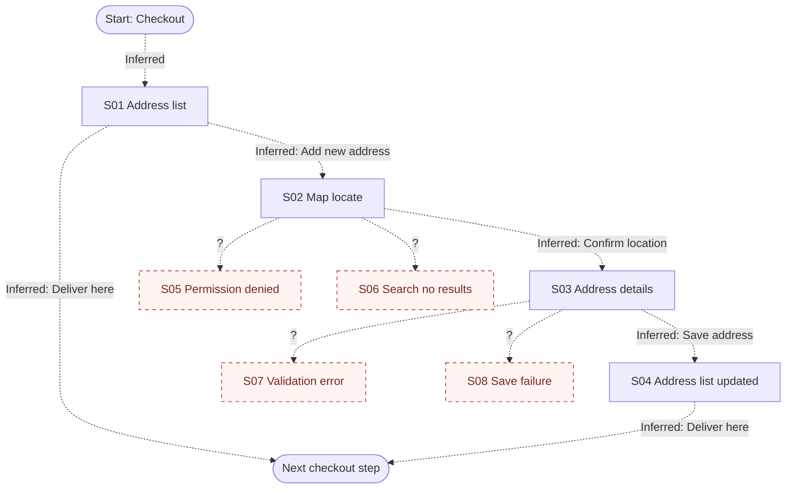

# T04 live run

Prompt: `/flowguard Review tests/fixtures/t04-no-prd/screens.md. I don't have a PRD. Help me establish the expected journey and identify missing states. Proceed with defaults if you need to.`
Execution method: live `/flowguard` invocation through the Skill tool (shared session; see test-cases.md). The user said to proceed with defaults, so no questions were asked; defaults are recorded as assumptions.
Date: 2026-10-19

---

# FlowGuard Audit: Add delivery address

## 1. Audit metadata

| Field | Value |
| --- | --- |
| Product or module | Delivery address selection and creation (checkout) |
| Audit mode | Standard |
| Audit date | Not provided |
| Requirements source | None: provisional journey |
| Design evidence | tests/fixtures/t04-no-prd/screens.md (4 frame descriptions) |
| Access method | Local file read |
| Artifacts not usable | None |
| Coverage limitations | Text descriptions only; no images, no prototype links |

## 2. Executive summary

Four frames describe a happy path for picking a saved address or adding a new one through a map pin and a details form. With no PRD, the expected journey below is provisional and built from common delivery-address conventions. The main path is coherent, but no failure, permission, empty, or validation states appear in the supplied evidence. The most important gaps are location permission handling for the map, map search with no results, and validation and save failure on the details form. Whether users can edit or delete saved addresses is an open question, not a finding.

**Summary of evidence**

- Requirements identified: 0 explicit, 6 provisional
- Screens and states inventoried: 10 (4 verified, 0 inferred, 6 missing from supplied evidence, 0 unknown)
- Transitions mapped: 6 (0 verified, 6 inferred, 0 unknown)
- Findings: 5 (P0: 0, P1: 0, P2: 3, P3: 2)
- Unresolved decisions: 3

These counts describe the supplied evidence. They do not measure completeness.

## 3. Evidence and assumptions

### Requirements

| ID | Requirement | Source | Status |
| --- | --- | --- | --- |
| PR01 | User can select a saved address and continue with "Deliver here". | Frames 1 and 4 | Provisional |
| PR02 | User can add a new address by locating it on a map, then entering details. | Frames 2 and 3 | Provisional |
| PR03 | If location permission is denied or unavailable, the user can still find the location by search or manual entry. | Domain convention for map pickers | Provisional |
| PR04 | Map search with no matching area shows a no-results message and a way forward. | Domain convention | Provisional |
| PR05 | Required detail fields are validated with inline errors before saving. | Domain convention; Landmark is the only field marked optional | Provisional |
| PR06 | If saving fails, the user sees an error, entered data is kept, and they can retry. | Domain convention | Provisional |

### Assumptions

| ID | Assumption | Reason | Impact if wrong |
| --- | --- | --- | --- |
| A01 | Primary user goal: choose where the order is delivered during checkout. (Default for question 1.) | "Deliver here" button | Journey and priorities change if this is a profile settings flow. |
| A02 | Success means the new or chosen address is selected and the user proceeds to the next checkout step. (Default for question 2.) | Frame 4 shows the new address selected | Terminal state may differ. |
| A03 | Scope is a single customer role on mobile. (Default for question 3.) | Map pin interaction pattern | Desktop or multi-role variants not reviewed. |
| A04 | First-time users with zero saved addresses enter the same flow. | Not stated | An empty address list state may be needed (see F05). |

## 4. Screen inventory

| ID | Name (alias) | Purpose | Category | Actions | Evidence | Classification | Notes |
| --- | --- | --- | --- | --- | --- | --- | --- |
| S01 | Address list ("Address list") | Pick a saved address | Entry | Select radio, "+ Add new address", "Deliver here" | Frame 1 | Verified | |
| S02 | Map locate ("Add address - map") | Set location | Form | Search area, move pin, "Confirm location" | Frame 2 | Verified | |
| S03 | Address details ("Add address - details") | Enter details | Form | Fields, label chips, "Save address" | Frame 3 | Verified | Landmark optional; others assumed required |
| S04 | Address list updated ("Address list - updated") | Confirm new address selected | Success | "Deliver here" | Frame 4 | Verified | |
| S05 | Location permission denied | Fallback when location is unavailable | Permission | Not provided | None | Missing from supplied evidence | PR03 |
| S06 | Map search no results | Recover from failed search | Empty | Not provided | None | Missing from supplied evidence | PR04 |
| S07 | Details validation error | Fix invalid input | Error | Not provided | None | Missing from supplied evidence | PR05 |
| S08 | Save failure | Recover from failed save | Error | Not provided | None | Missing from supplied evidence | PR06 |
| S09 | Save in progress | Feedback while saving | Loading | Not provided | None | Missing from supplied evidence | P3 |
| S10 | Empty address list (first-time user) | Start when nothing is saved | Empty | Not provided | None | Missing from supplied evidence | A04 |

## 5. Flow overview

The user starts at the saved address list, either picks an address and taps "Deliver here", or taps "+ Add new address", confirms a map location, fills in details, saves, and returns to the updated list with the new address selected. All transitions are inferred from frame names and button labels.

Legend: solid arrow = verified, dashed arrow = inferred, `?` label = condition unknown, dashed node border = missing from supplied evidence. The 4 `?` edges lead to missing states and are not counted as mapped transitions; the ENTRY edge is an entry point, not a transition. The 6 mapped transitions are T01 to T06 below.

## 6. Transition inventory

| ID | Source | Trigger | Condition | Destination | Evidence | Classification | Related reqs | Uncertainty |
| --- | --- | --- | --- | --- | --- | --- | --- | --- |
| T01 | S01 | "Deliver here" | Address selected | Next checkout step | Button label | Inferred | PR01 | Prototype link |
| T02 | S01 | "+ Add new address" | None | S02 | Link label, frame order | Inferred | PR02 | Prototype link |
| T03 | S02 | "Confirm location" | Pin placed | S03 | Frame order | Inferred | PR02 | Prototype link |
| T04 | S03 | "Save address" | Valid input, save succeeds | S04 | Frame order | Inferred | PR02 | Prototype link |
| T05 | S04 | "Deliver here" | None | Next checkout step | Button label | Inferred | PR01 | Prototype link |
| T06 | S02, S03 | Back | None | Previous screen | Platform convention | Inferred | PR02 | Whether entered data is kept |

## 7. Prioritized findings

### F01: Location permission denied state not designed

| Field | Detail |
| --- | --- |
| Category | Auth and permissions |
| Priority | P2: Provisional PR03; users who deny location can still use "Search area" as a workaround, so friction rather than a block |
| Evidence | S02 (frame 2) |
| Expected behavior | Explain that location is off and offer search or settings (PR03) |
| Observed behavior or limitation | No permission prompt or denied state in supplied evidence |
| User impact | Map may open at a default or wrong location with no explanation |
| Recommended fix | Add S05 with a short explanation, "Search instead" and "Enable location" actions |
| Classification and confidence | Missing from supplied evidence; Observation High, Requirement Medium (provisional) |
| Validation steps | Confirm with product whether the map requests location; review S05 design |
| Related IDs | S02, S05 |

### F02: Map search with no results not designed

| Field | Detail |
| --- | --- |
| Category | System behavior |
| Priority | P2: Provisional PR04; user can move the pin manually as a workaround |
| Evidence | S02 "Search area" field |
| Expected behavior | No-results message with suggestions (PR04) |
| Observed behavior or limitation | Only the default map state is supplied |
| User impact | User is unsure whether search failed or is loading |
| Recommended fix | Add S06 with a message and a hint to drag the pin |
| Classification and confidence | Missing from supplied evidence; Requirement Medium |
| Validation steps | Design review of S06 |
| Related IDs | S02, S06 |

### F03: Address details validation and save failure not designed

| Field | Detail |
| --- | --- |
| Category | Forms |
| Priority | P2: Provisional PR05 and PR06; blocks saving an address but the user can still pick a saved one |
| Evidence | S03 (frame 3) |
| Expected behavior | Inline errors on required fields (PR05); save error with data preserved and retry (PR06) |
| Observed behavior or limitation | Only the default form is supplied; no error, loading, or failure state |
| User impact | Users may not know why save did not work, and may lose entered details |
| Recommended fix | Add S07 inline errors, S08 save failure with "Try again", and S09 saving state on the button |
| Classification and confidence | Missing from supplied evidence; Requirement Medium |
| Validation steps | Confirm which fields are required; review S07 to S09 |
| Related IDs | S03, S07, S08, S09, T04 |

### F04: Back navigation data handling not shown

| Field | Detail |
| --- | --- |
| Category | Navigation |
| Priority | P3: minor, inferred convention |
| Evidence | S02, S03 have no visible back or cancel control in descriptions |
| Expected behavior | User can go back from details to the map without losing entered text |
| Observed behavior or limitation | No back or cancel control described |
| User impact | Possible loss of typed details |
| Recommended fix | Show a back control and specify whether details are kept |
| Classification and confidence | Missing from supplied evidence; Low requirement confidence |
| Validation steps | Confirm header pattern in full frames |
| Related IDs | T06 |

### F05: Empty saved-address list not designed

| Field | Detail |
| --- | --- |
| Category | System behavior |
| Priority | P3: first-time users could plausibly be sent straight to S02; depends on A04 |
| Evidence | S01 shows only a populated list |
| Expected behavior | Zero-address users see a prompt to add one, or skip to S02 |
| Observed behavior or limitation | Not found in supplied evidence |
| User impact | Confusing empty screen for new users |
| Recommended fix | Add S10 or define the skip rule |
| Classification and confidence | Missing from supplied evidence; Requirement Low |
| Validation steps | Confirm first-time user behavior with product |
| Related IDs | S01, S10 |

## 8. Recommended fixes

| Priority | Finding | Fix | Affected screens |
| --- | --- | --- | --- |
| P2 | F01 | Permission denied state with search fallback | S02, S05 |
| P2 | F02 | Search no-results state | S02, S06 |
| P2 | F03 | Validation, saving, and save-failure states | S03, S07, S08, S09 |
| P3 | F04 | Back control and data retention rule | S02, S03 |
| P3 | F05 | Empty list or skip rule | S01, S10 |

## 9. Developer-ready issues

### [FlowGuard F03] Address details: validation and save failure states

**Problem:** The details form has no designed error, saving, or failure states.
**Affected states:** S03, S07, S08, S09, T04
**Expected behavior:** Required fields show inline errors; save shows progress; failure keeps data and offers retry.
**Acceptance criteria:**
- Given House/Flat is empty, when the user taps "Save address", then an inline error appears and nothing is saved.
- Given the save request fails, when the error is shown, then all entered values remain and "Try again" is available.
**Test scenarios:**
1. Submit empty required fields.
2. Simulate save failure and retry.
**Source:** FlowGuard audit of Add delivery address, finding F03 (Missing from supplied evidence).

## 10. Validation checklist

- [ ] Confirm A01 to A04 with the product owner.
- [ ] Confirm which detail fields are required.
- [ ] Review designs for S05 to S10.
- [ ] Confirm whether edit and delete of saved addresses are in scope (Q01).

## 11. Unresolved decisions

| ID | Question | Why it matters | Suggested owner | Default if no answer |
| --- | --- | --- | --- | --- |
| Q01 | Can users edit or delete saved addresses from S01? | Adds edit, delete confirmation, and undo states | Product owner (suggested) | Out of scope for this flow |
| Q02 | Is there a serviceability check (address outside delivery area)? | Would add an "unavailable here" branch | Product owner (suggested) | No check in this flow |
| Q03 | Is there a limit on the number of saved addresses? | Would add a limit-reached state | Product owner (suggested) | No limit |

## 12. Scope and limitations

- This audit reviewed static design evidence. It does not verify live product behavior.
- No PRD was supplied; every requirement is Provisional and must be confirmed by the team.
- Frames are text descriptions; layout, visuals, and accessibility were not reviewed.
- FlowGuard does not guarantee a flow is complete and does not replace usability testing.

---

Summary: reviewed 4 frames with no PRD; built 6 provisional requirements with defaults recorded as A01 to A03. Top findings: F01 P2 location permission denied, F02 P2 search no results, F03 P2 validation and save failure. Edit or delete of addresses raised as Q01. No files were saved.
