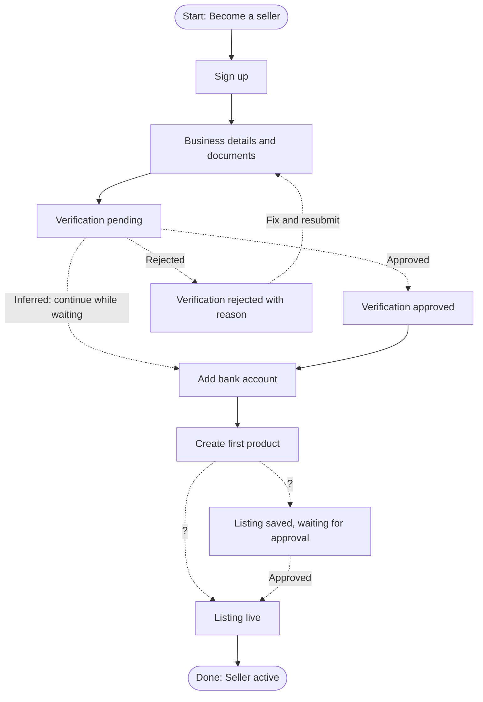

# T05 live run

Prompt: `/flowguard I am designing a seller onboarding feature. Help me map the expected journey and identify the states I should consider. Context is in tests/fixtures/t05-idea-only/brief.md.`
Execution method: live `/flowguard` invocation through the Skill tool (shared session; see test-cases.md).
Date: 2026-10-19

---

# FlowGuard Journey Plan: Seller onboarding

> No design evidence was supplied. This is a planning checklist, not an audit of existing screens.

## 1. Context and assumptions

Source: tests/fixtures/t05-idea-only/brief.md (Read). New marketplace sellers sign up, verify their business, add a payout bank account, and list a first product. Verification can take up to 2 business days and can be rejected.

| ID | Assumption | Reason |
| --- | --- | --- |
| A01 | Sellers can add a bank account and draft a product while verification is pending; the listing goes live only after approval. | Brief does not say whether steps are sequential; parallel steps reduce waiting time. |
| A02 | Single seller role; one person completes onboarding. | Not stated. |
| A03 | Verification is done by a review team or provider outside the app, with the result sent back by notification. | "Up to 2 business days" implies asynchronous review. |

## 2. Expected journey (provisional)

| ID | Step | Status |
| --- | --- | --- |
| R01 | Sign up as a seller. | Explicit (brief) |
| R02 | Submit business verification details and documents. | Explicit (brief) |
| R03 | Wait for verification, up to 2 business days. | Explicit (brief) |
| R04 | Verification can be rejected. | Explicit (brief) |
| R05 | Add a bank account for payouts. | Explicit (brief) |
| R06 | List the first product. | Explicit (brief) |
| PR01 | Rejected sellers see the reason and can fix and resubmit. | Provisional |
| PR02 | Sellers are notified when verification finishes. | Provisional |
| PR03 | Sellers can leave and resume onboarding where they left off. | Provisional |
| PR04 | Bank account details are validated before payouts are enabled. | Provisional |

## 3. Flow diagram (proposed)

All edges are proposals. Dashed edges depend on decisions in section 6.

## 4. States to design

| Proposed ID | State | Why it is needed | Priority to design | Requirement status |
| --- | --- | --- | --- | --- |
| P01 | Sign up form, with errors and existing-account case | Entry point | High | Explicit (R01) |
| P02 | Business details and document upload, with upload progress, failure, unsupported file | Verification input | High | Explicit (R02) |
| P03 | Verification pending, showing expected wait and what the seller can do meanwhile | 2-day wait | High | Explicit (R03) |
| P04 | Verification approved | Unblocks selling | High | Explicit (R03) |
| P05 | Verification rejected, with reason and resubmit path | Can be rejected | High | Explicit (R04), PR01 |
| P06 | Bank account form, with validation error and verification state | Payouts | High | Explicit (R05), PR04 |
| P07 | First product form, with draft save, validation, and image upload failure | First listing | High | Explicit (R06) |
| P08 | Listing live | Success | Medium | Explicit (R06) |
| P09 | Listing waiting for seller approval | If A01 holds | Medium | Provisional |
| P10 | Resume onboarding (progress checklist) | Long journey with a wait | Medium | PR03 |
| P11 | Verification result notification (email or push) | Async result | Medium | PR02 |
| P12 | Network or server error with retry on each submit step | Any server call | Medium | Provisional |

## 5. Edge cases to decide

- Rejected more than once: is there a resubmission limit or a support contact?
- Verification takes longer than 2 business days: what does the pending state say?
- Bank account name does not match the verified business name.
- Seller changes business details after approval: does it trigger re-verification?
- Document upload: file types, size limits, blurry or expired documents.
- Seller abandons mid-way: are drafts kept, and for how long?

## 6. Open questions

| ID | Question | Default if no answer |
| --- | --- | --- |
| Q01 | Are bank account and first product blocked until verification is approved? | A01: allowed, listing goes live after approval |
| Q02 | What rejection reasons exist, and which are fixable by resubmitting? | Show reason text and a resubmit action for all |
| Q03 | How is the seller told the verification result? | Email and in-app banner |
| Q04 | Is there a limit on resubmissions? | No limit; show support contact after second rejection |

## 7. Next steps

1. Answer Q01 to Q04.
2. Design P01 to P07 including their error states.
3. Run FlowGuard again with the designs and this plan as requirements for an audit.

---

Summary: planning output from a feature brief only; no screens were audited and no audit findings were produced. Proposed journey covers sign up, verification pending, approved, rejected and resubmit, bank account, and first listing; 12 states to design and 4 open questions. No files were saved.
