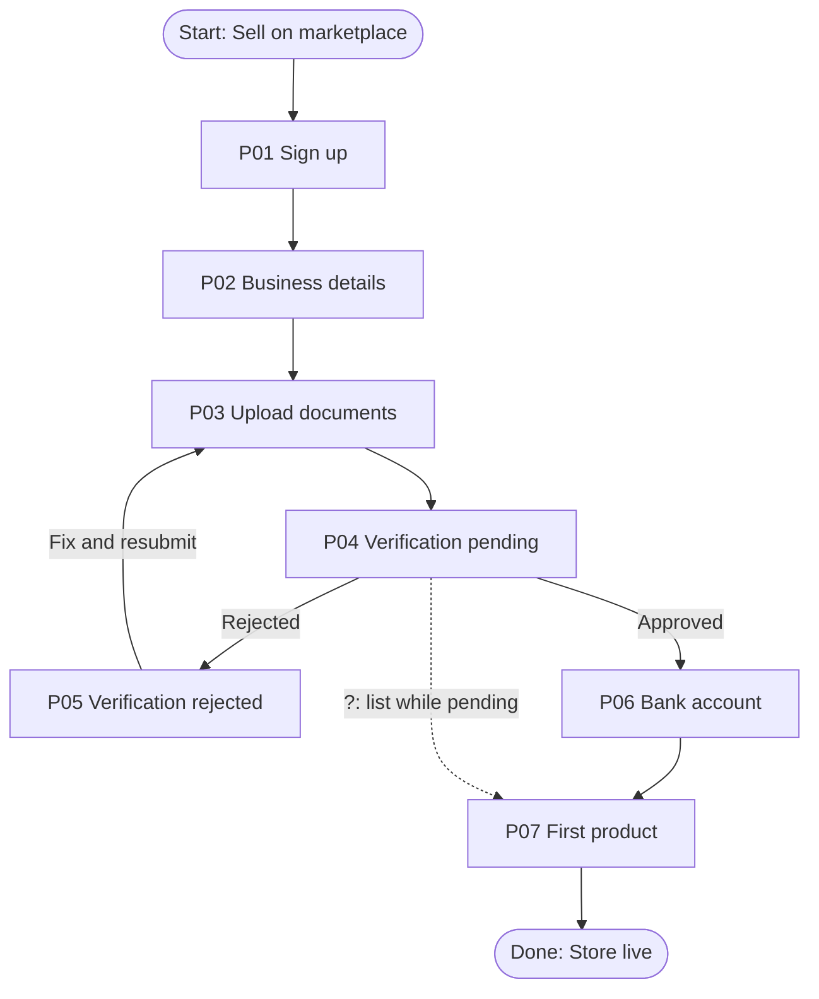

# T05 run output

Prompt: `/flowguard I am designing a seller onboarding feature. Help me map the expected journey and identify the states I should consider. Context is in tests/fixtures/t05-idea-only/brief.md.`
Execution method: manual execution of SKILL.md in the authoring session.

---

# FlowGuard Journey Plan: Seller onboarding

> No design evidence was supplied. This is a planning checklist, not an audit of existing screens.

## 1. Context and assumptions

New marketplace sellers sign up, verify their business, add a payout bank account, and list a first product. Verification can take up to 2 business days and can be rejected (brief).

- A01: Sellers can save progress and return later (assumed; verification is asynchronous).
- A02: Listing a product is allowed before verification completes, but the listing stays unpublished (assumed; confirm, see Q01).

## 2. Expected journey (provisional)

1. Sign up (account creation, email or phone verification).
2. Business details (legal name, tax ID, address).
3. Document upload for verification.
4. Verification pending (up to 2 business days).
5. Verification outcome: approved or rejected with reasons.
6. Bank account for payouts (entry, validation, possibly micro-deposit check).
7. First product listing.
8. Onboarding complete: store live.

## 3. Flow diagram (proposed)

## 4. States to design

| Proposed ID | State | Why it is needed | Priority to design | Requirement status |
| --- | --- | --- | --- | --- |
| P01 | Sign up with duplicate account error | Existing users re-registering | High | Provisional |
| P03 | Upload errors (wrong format, too large, unreadable) | Verification depends on documents | High | Provisional |
| P04 | Verification pending with expected time and notification | Brief: up to 2 business days | High | Explicit (brief) |
| P05 | Rejected with reasons and resubmit path | Brief: can be rejected | High | Explicit (brief) |
| P06 | Bank details invalid or name mismatch | Payouts fail otherwise | High | Provisional |
| P08 | Resume onboarding after leaving | Multi-day journey | High | Provisional (A01) |
| P09 | Progress indicator across steps | Long multi-step flow | Medium | Provisional |
| P10 | Product listing draft saved but unpublished | Depends on Q01 | Medium | Provisional |

## 5. Edge cases to decide

- Verification taking longer than 2 business days.
- Resubmission limits after repeated rejection.
- Changing bank details after verification.
- Multiple users managing one seller account.

## 6. Open questions

- Q01: Can sellers list products before verification is approved?
- Q02: Is bank verification instant or does it need a deposit check?
- Q03: How are sellers notified of the verification result (email, push, in-app)?

## 7. Next steps

Answer Q01 to Q03, design the High priority states, then run FlowGuard again with the designs for a full audit.
