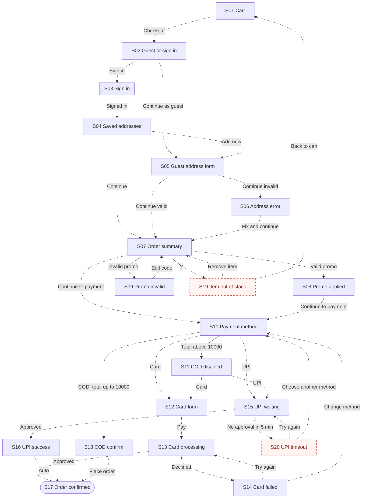

# T12 live run

Prompt: `/flowguard Standard audit of tests/fixtures/t12-large-flow/screens.md against tests/fixtures/t12-large-flow/requirements.md.`
Execution method: live `/flowguard` invocation through the Skill tool (shared session; see test-cases.md). Summary counts were recounted by script from the tables and the diagram after writing (see the note at the end).
Date: 2026-10-19

---

# FlowGuard Audit: Checkout

## 1. Audit metadata

| Field | Value |
| --- | --- |
| Product or module | Checkout (cart to order confirmation) |
| Audit mode | Standard |
| Audit date | Not provided |
| Requirements source | tests/fixtures/t12-large-flow/requirements.md, R01 to R09 |
| Design evidence | tests/fixtures/t12-large-flow/screens.md, 18 frame descriptions |
| Access method | Local file read |
| Artifacts not usable | None |
| Coverage limitations | Text descriptions only; no prototype links; "Sign in" is a shared component and its internals were not reviewed |

## 2. Executive summary

Eighteen frames cover a checkout with guest and signed-in branches, promo codes, and three payment methods. Most required branches are designed: guest address validation, valid and invalid promo, COD disabled above 10,000, card failure with retry, UPI waiting, and confirmation. Two required states are missing from the supplied evidence: the out-of-stock state during checkout (R06) and the UPI approval timeout (R07). Expired promo codes do not have a message distinct from invalid ones. The biggest unknown is at which step stock is re-checked.

**Summary of evidence**

- Requirements identified: 9 explicit, 0 provisional
- Screens and states inventoried: 20 (18 verified, 0 inferred, 2 missing from supplied evidence, 0 unknown)
- Transitions mapped: 34 (0 verified, 28 inferred, 6 missing from supplied evidence, 0 unknown)
- Findings: 4 (P0: 0, P1: 2, P2: 1, P3: 1)
- Unresolved decisions: 3

These counts describe the supplied evidence. They do not measure completeness.

## 3. Evidence and assumptions

### Requirements

| ID | Requirement | Source | Status |
| --- | --- | --- | --- |
| R01 | Guest or signed-in checkout | requirements.md | Explicit |
| R02 | Signed-in users see saved addresses; guests enter one | requirements.md | Explicit |
| R03 | Valid promo applies discount; invalid or expired codes show a specific message | requirements.md | Explicit |
| R04 | Payment by card, UPI, COD | requirements.md | Explicit |
| R05 | COD unavailable above 10,000, with reason | requirements.md | Explicit |
| R06 | Item out of stock during checkout: show which item; remove it or go back to cart | requirements.md | Explicit |
| R07 | UPI waiting message; timeout after 5 minutes with "Try again" or "Choose another method" | requirements.md | Explicit |
| R08 | Card failure shows reason and allows retry | requirements.md | Explicit |
| R09 | Success shows order confirmation | requirements.md | Explicit |

### Assumptions

| ID | Assumption | Reason | Impact if wrong |
| --- | --- | --- | --- |
| A01 | "Add new" on S04 opens the same address form as S05. | No separate frame | A signed-in add-address form may be missing |
| A02 | Out-of-stock is detected when moving from order summary to payment. | R06 says "during checkout" without a step | The missing state may be needed at several steps |

## 4. Screen inventory

| ID | Name (alias) | Purpose | Category | Actions | Evidence | Classification | Notes |
| --- | --- | --- | --- | --- | --- | --- | --- |
| S01 | Cart ("Cart") | Start checkout | Entry | Checkout | Frame 1 | Verified | |
| S02 | Checkout choose ("Checkout - choose") | Guest or sign in | Form | Continue as guest, Sign in | Frame 2 | Verified | R01 |
| S03 | Sign in ("Sign in") | Authenticate | External handoff | Not provided | Frame 3 | Verified | Shared component |
| S04 | Saved addresses ("Address - saved list") | Pick address | Form | Add new, Continue | Frame 4 | Verified | R02 |
| S05 | Guest address form ("Address - guest form") | Enter address | Form | Continue | Frame 5 | Verified | R02 |
| S06 | Guest address error ("Address - guest form error") | Fix input | Error | Continue | Frame 6 | Verified | |
| S07 | Order summary ("Order summary") | Review, promo | Review | Apply promo, Continue to payment | Frame 7 | Verified | |
| S08 | Promo applied ("Promo applied") | Discount shown | Success | Continue to payment | Frame 8 | Verified | R03 |
| S09 | Promo invalid ("Promo invalid") | Invalid code | Error | Edit code | Frame 9 | Verified | R03, same message for expired |
| S10 | Payment method ("Payment - choose method") | Choose method | Form | Card, UPI, COD | Frame 10 | Verified | R04 |
| S11 | COD disabled ("Payment - COD disabled") | Explain COD limit | Informational | Card, UPI | Frame 11 | Verified | R05 |
| S12 | Card form ("Card form") | Enter card | Form | Pay | Frame 12 | Verified | |
| S13 | Card processing ("Card processing") | Wait | Loading | None | Frame 13 | Verified | |
| S14 | Card failed ("Card failed") | Recover | Error | Try again, Change method | Frame 14 | Verified | R08 |
| S15 | UPI waiting ("UPI waiting") | Wait for approval | Loading | None described | Frame 15 | Verified | R07, countdown 5:00 |
| S16 | UPI success ("UPI success") | Approval received | Success | None | Frame 16 | Verified | Merges into S17 |
| S17 | Order confirmed ("Order confirmed") | Confirmation | Terminal | Track order | Frame 17 | Verified | R09 |
| S18 | COD confirm ("COD confirm") | Confirm COD | Review | Place order | Frame 18 | Verified | |
| S19 | Item out of stock | Show item, remove or go back | Error | Remove item, Back to cart | None | Missing from supplied evidence | R06 |
| S20 | UPI timeout | Recover from no approval | Error | Try again, Choose another method | None | Missing from supplied evidence | R07 |

## 5. Flow overview

From the cart (S01) the user chooses guest or sign in (S02). Signed-in users pass through the shared sign in (S03) to saved addresses (S04); guests fill the address form (S05) with an error state (S06). Both reach the order summary (S07), where promo codes branch to applied (S08) or invalid (S09). Payment choice (S10, or S11 when COD is disabled) branches into card (S12 to S14), UPI (S15, S16), or COD (S18), all ending at order confirmed (S17). The out-of-stock state (S19) and UPI timeout (S20) are drawn as missing.

Legend: solid arrow = verified, dashed arrow = inferred, `?` label = condition unknown, dashed node border = missing from supplied evidence. The diagram has 20 nodes and 34 edges, one per transition T01 to T34.

## 6. Transition inventory

| ID | Source | Trigger | Condition | Destination | Evidence | Classification | Related reqs | Uncertainty |
| --- | --- | --- | --- | --- | --- | --- | --- | --- |
| T01 | S01 | Checkout | None | S02 | Button label | Inferred | R01 | Prototype link |
| T02 | S02 | Continue as guest | None | S05 | Button label | Inferred | R01, R02 | Prototype link |
| T03 | S02 | Sign in | None | S03 | Button label | Inferred | R01 | Prototype link |
| T04 | S03 | Sign in succeeds | Signed in | S04 | R02 | Inferred | R02 | Component return path |
| T05 | S04 | Continue | Address selected | S07 | Frame order | Inferred | R02 | Prototype link |
| T06 | S04 | Add new | None | S05 | A01 | Inferred | R02 | Whether S05 is reused |
| T07 | S05 | Continue | Invalid input | S06 | Frame 6 | Inferred | R02 | Prototype link |
| T08 | S05 | Continue | Valid input | S07 | Frame order | Inferred | R02 | Prototype link |
| T09 | S06 | Continue | Errors fixed | S07 | Frame order | Inferred | R02 | Prototype link |
| T10 | S07 | Apply promo | Valid code | S08 | Frame 8 | Inferred | R03 | Prototype link |
| T11 | S07 | Apply promo | Invalid code | S09 | Frame 9 | Inferred | R03 | Prototype link |
| T12 | S07 | Continue to payment | None | S10 | Button label | Inferred | R04 | Prototype link |
| T13 | S08 | Continue to payment | None | S10 | Button label | Inferred | R04 | Prototype link |
| T14 | S09 | Edit code | None | S07 | Convention | Inferred | R03 | Prototype link |
| T15 | S10 | Card | None | S12 | Option label | Inferred | R04 | Prototype link |
| T16 | S10 | UPI | None | S15 | Option label | Inferred | R04, R07 | Prototype link |
| T17 | S10 | COD | Total up to 10,000 | S18 | Option label, R05 | Inferred | R04, R05 | Prototype link |
| T18 | S10 | System | Total above 10,000 | S11 | R05 | Inferred | R05 | Whether S11 is a variant of S10 |
| T19 | S11 | Card | None | S12 | Option label | Inferred | R04 | Prototype link |
| T20 | S11 | UPI | None | S15 | Option label | Inferred | R04 | Prototype link |
| T21 | S12 | Pay | Valid card | S13 | Button label | Inferred | R04 | Prototype link |
| T22 | S13 | System | Payment approved | S17 | R09 | Inferred | R09 | Prototype link |
| T23 | S13 | System | Payment declined | S14 | R08 | Inferred | R08 | Prototype link |
| T24 | S14 | Try again | None | S13 | Button label, R08 | Inferred | R08 | Whether card form is shown again |
| T25 | S14 | Change method | None | S10 | Button label | Inferred | R04 | Prototype link |
| T26 | S15 | System | Approved in UPI app | S16 | Frame 16 | Inferred | R07 | Prototype link |
| T27 | S16 | System | None | S17 | Frame 16 note | Inferred | R09 | Prototype link |
| T28 | S18 | Place order | None | S17 | Button label | Inferred | R09 | Prototype link |
| T29 | S07 | System | Item out of stock (step Unknown) | S19 | R06 | Missing from supplied evidence | R06 | Q01 |
| T30 | S15 | System | No approval in 5 minutes | S20 | R07 | Missing from supplied evidence | R07 | Design needed |
| T31 | S19 | Remove item | None | S07 | R06 | Missing from supplied evidence | R06 | Design needed |
| T32 | S19 | Back to cart | None | S01 | R06 | Missing from supplied evidence | R06 | Design needed |
| T33 | S20 | Try again | None | S15 | R07 | Missing from supplied evidence | R07 | Design needed |
| T34 | S20 | Choose another method | None | S10 | R07 | Missing from supplied evidence | R07 | Design needed |

## 7. Prioritized findings

### F01: Out-of-stock state during checkout not designed

| Field | Detail |
| --- | --- |
| Category | Conditional branches |
| Priority | P1: Required by R06; user cannot complete or adjust the order when stock changes; Missing from supplied evidence (all 18 frames reviewed) |
| Evidence | R06; no frame shows an out-of-stock message |
| Expected behavior | Show which item is out of stock, with "Remove item" and "Back to cart" (R06) |
| Observed behavior or limitation | Not found in the supplied evidence |
| User impact | Users may hit a generic failure or pay for an unavailable item |
| Recommended fix | Add S19 with the item, "Remove item" returning to S07, and "Back to cart" returning to S01 |
| Classification and confidence | Missing from supplied evidence; Observation High, Requirement High |
| Validation steps | Review S19 design; confirm the stock check step (Q01) |
| Related IDs | S07, S19, T29, T31, T32 |

### F02: UPI approval timeout not designed

| Field | Detail |
| --- | --- |
| Category | Recovery |
| Priority | P1: Required by R07; users stuck after 5 minutes have no designed recovery; Missing from supplied evidence |
| Evidence | R07; S15 shows a 5:00 countdown but no timeout state |
| Expected behavior | Timeout with "Try again" and "Choose another method" (R07) |
| Observed behavior or limitation | Not found in the supplied evidence |
| User impact | Payment abandoned or duplicated |
| Recommended fix | Add S20 with both actions |
| Classification and confidence | Missing from supplied evidence; High |
| Validation steps | Review S20; test countdown expiry in prototype |
| Related IDs | S15, S20, T30, T33, T34 |

### F03: Expired promo code has no specific message

| Field | Detail |
| --- | --- |
| Category | Business rules and data |
| Priority | P2: R03 asks for a specific message for invalid or expired codes; the user can still continue without a discount |
| Evidence | S09 shows only "This code isn't valid" |
| Expected behavior | Distinct messages for invalid and expired codes (R03) |
| Observed behavior or limitation | One generic message |
| User impact | Users with an expired code do not know why it failed |
| Recommended fix | Add an expired variant of S09, for example "This code has expired" |
| Classification and confidence | Verified (message text); Requirement Medium (wording of R03 allows a single message) |
| Validation steps | Confirm R03 intent with product |
| Related IDs | S09, T11 |

### F04: No cancel or change-method action while waiting for UPI approval

| Field | Detail |
| --- | --- |
| Category | Navigation |
| Priority | P3: Provisional; user can wait for the timeout once S20 exists |
| Evidence | S15 describes no actions |
| Expected behavior | Option to cancel and choose another method while waiting (Provisional) |
| Observed behavior or limitation | Not found in supplied evidence |
| User impact | Up to 5 minutes of waiting if the user changes their mind |
| Recommended fix | Add "Use another method" on S15 |
| Classification and confidence | Missing from supplied evidence; Requirement Low |
| Validation steps | Design review |
| Related IDs | S15 |

## 8. Recommended fixes

| Priority | Finding | Fix | Affected screens |
| --- | --- | --- | --- |
| P1 | F01 | Out-of-stock state with remove and back to cart | S07, S19 |
| P1 | F02 | UPI timeout with retry and other method | S15, S20 |
| P2 | F03 | Expired promo message | S09 |
| P3 | F04 | Cancel option while waiting for UPI | S15 |

## 9. Developer-ready issues

### [FlowGuard F01] Checkout: out-of-stock state

**Problem:** No design exists for an item going out of stock during checkout.
**Affected states:** S07, S19, T29, T31, T32
**Expected behavior:** Name the item; offer "Remove item" and "Back to cart".
**Acceptance criteria:**
- Given an item goes out of stock before payment, when the user continues, then S19 names the item and offers both actions.
**Test scenarios:**
1. Remove the item and complete checkout.
2. Go back to cart and edit quantities.
**Source:** FlowGuard audit of Checkout, finding F01 (Missing from supplied evidence).

### [FlowGuard F02] Checkout: UPI timeout

**Problem:** No state for UPI approval not received within 5 minutes.
**Affected states:** S15, S20, T30, T33, T34
**Expected behavior:** Timeout message with "Try again" and "Choose another method".
**Acceptance criteria:**
- Given the countdown reaches 0:00 without approval, then S20 appears with both actions.
**Test scenarios:**
1. Let the countdown expire, retry UPI.
2. Let it expire, switch to card.
**Source:** FlowGuard audit of Checkout, finding F02 (Missing from supplied evidence).

## 10. Validation checklist

- [ ] S19 and S20 designed and linked.
- [ ] Expired promo message confirmed.
- [ ] Stock check step decided (Q01).
- [ ] Sign in component returns to S04 with the cart intact.

## 11. Unresolved decisions

| ID | Question | Why it matters | Suggested owner | Default if no answer |
| --- | --- | --- | --- | --- |
| Q01 | At which step is stock re-checked? | Determines where S19 appears | Engineering (suggested) | Before payment (A02) |
| Q02 | Does "Add new" on S04 reuse S05? | A signed-in form may be missing | Design (suggested) | Reuse S05 (A01) |
| Q03 | Can a signed-in user with no saved addresses reach S04? | Empty list state | Product owner (suggested) | Go straight to S05 |

## 12. Scope and limitations

- This audit reviewed static design evidence. It does not verify live product behavior.
- All transitions are Inferred from labels, frame order, and requirements; no prototype data was supplied.
- The shared "Sign in" component was not reviewed.
- The Mermaid diagram was checked against the template rules and its edge count was compared with the transition table by script; it was not rendered in this run.
- FlowGuard does not guarantee a flow is complete and does not replace usability testing.

---

Summary: reviewed 18 frames against 9 explicit requirements. Top findings: F01 P1 out-of-stock state missing (R06), F02 P1 UPI timeout missing (R07), F03 P2 expired promo message. Card failure, promo invalid, and COD disabled states are present. Not verified: prototype links, sign in internals. No files were saved.
