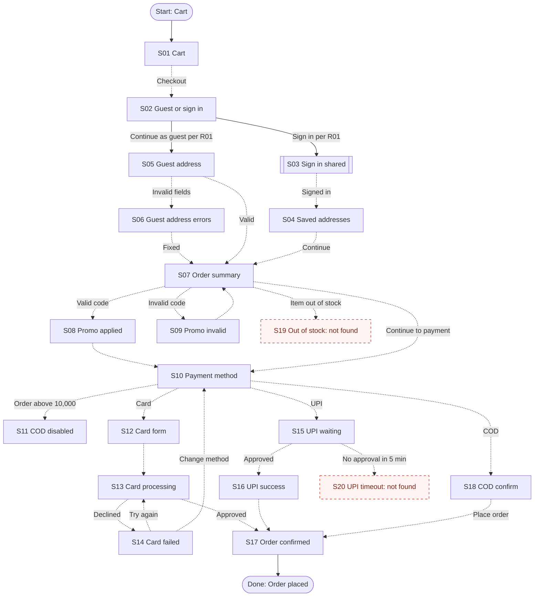

# T12 run output

Prompt: `/flowguard Standard audit of tests/fixtures/t12-large-flow/screens.md against tests/fixtures/t12-large-flow/requirements.md.`
Execution method: manual execution of SKILL.md in the authoring session. Sections condensed where marked.

---

# FlowGuard Audit: Checkout

## 1. Audit metadata

| Field | Value |
| --- | --- |
| Product or module | Checkout (fictional fixture) |
| Audit mode | Standard |
| Audit date | Not provided |
| Requirements source | `t12-large-flow/requirements.md` (R01 to R09) |
| Design evidence | `t12-large-flow/screens.md` (18 frames, text) |
| Access method | Local file read |
| Artifacts not usable | None |
| Coverage limitations | Text descriptions; no prototype data; "Sign in" is a shared component and was not audited. |

## 2. Executive summary

The designs cover both entry branches (guest and signed in), promo outcomes, all three payment methods, COD restriction, and card failure with retry. Two required branches were not found: the out-of-stock interruption (R06) and the UPI timeout with recovery (R07). Expired promo codes share the generic invalid message, which R03 asks to be specific.

- Requirements identified: 9 explicit, 0 provisional
- Screens and states inventoried: 20 (18 verified, 2 missing from supplied evidence)
- Transitions mapped: 27 (2 verified, 21 inferred, 4 missing from supplied evidence)
- Findings: 3 (P0: 0, P1: 2, P2: 1, P3: 0)
- Unresolved decisions: 2

These counts describe the supplied evidence. They do not measure completeness.

## 4. Screen inventory (condensed)

S01 Cart, S02 Checkout choose, S03 Sign in (shared), S04 Address saved list, S05 Guest address form, S06 Guest address errors, S07 Order summary, S08 Promo applied, S09 Promo invalid, S10 Payment method, S11 COD disabled, S12 Card form, S13 Card processing, S14 Card failed, S15 UPI waiting, S16 UPI success, S17 Order confirmed, S18 COD confirm: all Verified. S19 Out of stock interruption and S20 UPI timeout: Missing from supplied evidence.

## 5. Flow overview

## 7. Prioritized findings

### F01: Out-of-stock interruption is not designed

| Field | Detail |
| --- | --- |
| Category | Conditional branches |
| Priority | P1: Required by R06; the user cannot complete or adjust the order; workaround unclear; Missing from supplied evidence (18 frames reviewed). |
| Expected behavior | Show which item is unavailable with "Remove item" and "Back to cart" (R06). |
| Observed behavior or limitation | No frame represents this state. Where it can occur (summary, payment, or place order) is not specified. |
| User impact | Users may be blocked at payment with no explanation. |
| Recommended fix | Add S19 as an interrupt reachable from S07 and from payment submission. |
| Classification and confidence | Missing from supplied evidence; Observation: High. Requirement: High. |
| Validation steps | Confirm the trigger points with engineering; design S19; walk through with one item and with all items out of stock. |
| Related IDs | S07, S10, S19 |

### F02: UPI timeout and recovery are not designed

| Field | Detail |
| --- | --- |
| Category | System behavior |
| Priority | P1: Required by R07; a timed-out payment leaves users without a path; Missing from supplied evidence. |
| Expected behavior | After 5 minutes without approval, show a timeout with "Try again" and "Choose another method" (R07). |
| Observed behavior or limitation | S15 shows a 5:00 countdown; no state for reaching zero or for a declined UPI request. |
| User impact | Users may pay twice or abandon the order. |
| Recommended fix | Add S20 with both actions; consider a declined-in-app variant. |
| Classification and confidence | Missing from supplied evidence; Observation: High. Requirement: High. |
| Validation steps | Design S20; confirm with engineering how a late approval after timeout is handled. |
| Related IDs | S15, S20 |

### F03: Expired promo code uses the generic invalid message

| Field | Detail |
| --- | --- |
| Category | Forms |
| Priority | P2: R03 asks for a specific message for invalid or expired codes; users have a workaround (remove code). |
| Expected behavior | Distinct copy for expired versus invalid codes. |
| Observed behavior or limitation | S09 shows only "This code isn't valid". |
| User impact | Users may retype a correct but expired code. |
| Recommended fix | Add an expired variant of S09. |
| Classification and confidence | Verified (copy observed); Requirement: Medium (R03 wording could allow one message). |
| Validation steps | Confirm R03 intent with the product owner. |
| Related IDs | S09 |

## 11. Unresolved decisions

- Q01: Where in the flow is stock re-checked (summary, payment, place order)?
- Q02: Can guests save their address or create an account after the order?

## 12. Scope and limitations

- Card failure (S14), promo invalid (S09), and COD disabled (S11) are designed and were not reported as missing.
- Static text descriptions only; most transitions Inferred from frame order and labels.
